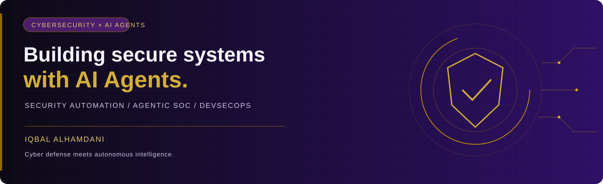

  

<h2 align="center">Hi, I'm Iqbal Alhamdani</h2>

<strong>Cybersecurity · AI Agents · DevSecOps</strong>

<em>Engineering secure automation and intelligent cyber defense.</em>

  
  
  

---

### `> whoami`

I work in security operations and build tools that make investigation and response more practical. My interests connect cybersecurity, application security, and AI agents—with a focus on secure, useful automation.

- **Cyber defense:** SOC monitoring, threat hunting, and incident investigation.
- **Security engineering:** application security and DevSecOps practices.
- **AI exploration:** agent-assisted alert triage, threat intelligence, and security workflows.

### `> focus`

| Cybersecurity | AI Agents | Secure Engineering |
| :--- | :--- | :--- |
| SIEM monitoring & investigation | Agent-assisted investigations | Application security |
| Threat hunting & detection | Threat intelligence workflows | API & automation tooling |
| Incident analysis | Human-reviewed security automation | DevSecOps |

### `> toolbox`

**Security operations**  
Elastic / Kibana · Wazuh · SIEM · Threat Hunting

**Development & automation**  
Python · JavaScript · Node.js · FastAPI · React

**Infrastructure & data**  
Linux · Docker · PostgreSQL · Redis

### `> lab_notes`

Areas I'm exploring:

- **Agentic SOC** — enriching alerts and supporting analyst decisions.
- **Threat intelligence automation** — organizing indicators and investigation context.
- **Secure AI workflows** — clear permissions, review steps, and traceable actions.

These are areas of exploration; published implementations can be found in my repositories.

<a href="https://github.com/alhamdaniiqbal?tab=repositories"><strong>Explore my repositories →</strong></a>

---

Build fast with AI. Secure by design.

