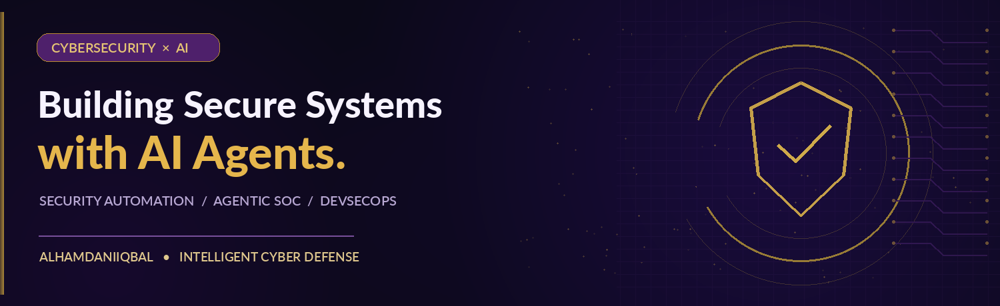

<div align="center">



<br />

### Hi, I'm Iqbal Alhamdani

**Cybersecurity · AI Agents · DevSecOps**

*Engineering secure automation and intelligent cyber defense.*

[](https://github.com/alhamdaniiqbal)


</div>

---

### `> whoami`

I'm interested in the intersection of **cyber defense, autonomous AI agents, and secure software engineering**. My focus is on exploring practical ways to make security monitoring, investigation, and engineering workflows more reliable and efficient.

```text
$ mission --focus cyber-ai
[+] Detect     Security monitoring & threat analysis
[+] Analyze    Threat intelligence & detection engineering
[+] Automate   Agentic workflows & security orchestration
[+] Secure     Application security & DevSecOps
```

### Core areas

| Cybersecurity | AI & Automation |
| :--- | :--- |
| SOC monitoring and incident triage | AI agent workflows |
| Threat hunting and threat intelligence | LLM-assisted security analysis |
| SIEM and detection engineering | Python and automation scripting |
| Application security and DevSecOps | Human-in-the-loop orchestration |

### Technology & tools

<div align="center">


</div>

### Security lab — areas of exploration

These are **areas of interest**, not claims that repositories have already been published.

| Research area | Direction |
| :--- | :--- |
| **Agentic SOC** | AI-assisted alert triage, enrichment, and analyst review |
| **Threat Intelligence Automation** | IOC enrichment and repeatable investigation workflows |
| **Detection Engineering** | SIEM rules, log parsing, and validation |
| **Secure AI Systems** | Agent safety, access controls, and auditable automation |

### GitHub activity

<div align="center">

## GitHub Activity

Explore my open-source contributions, cybersecurity projects, and AI security research.

[](https://github.com/alhamdaniiqbal?tab=overview)


<sub>Activity graph is provided by a third-party service and may occasionally be unavailable.</sub>

</div>

---

<div align="center">

**DETECT · ANALYZE · AUTOMATE · DEFEND**

<sub>Building secure systems, one workflow at a time.</sub>

</div>
